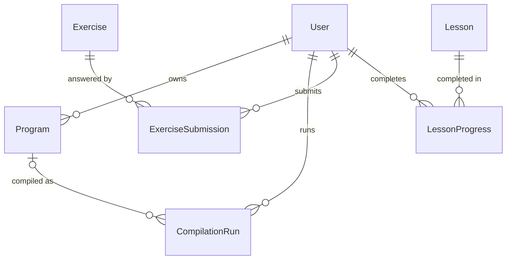

# Database design

PostgreSQL on Neon, accessed through Prisma. The schema is in `server/prisma/schema.prisma`
and the migrations in `server/prisma/migrations`.

## Tables

| Table | Purpose | Key fields |
|---|---|---|
| User | Accounts | `email` (unique), `passwordHash`, `role` (STUDENT or ADMIN) |
| Program | A saved program | `title`, `sourceCode`, `userId` |
| CompilationRun | One compile, stored as JSON per phase | `status`, `tokens`, `syntaxTree`, `symbolTable`, `intermediateCode`, `optimizedCode`, `targetCode`, `errors` |
| Lesson | Teaching content | `title`, `description`, `content`, `category`, `difficulty` |
| Exercise | A practice task | `instructions`, `starterCode`, `expectedConcept` (answer key), `difficulty` |
| ExerciseSubmission | A student's attempt | `sourceCode`, `result` (JSON with `passed` and `feedback`) |
| LessonProgress | Completed lessons | unique `(userId, lessonId)` |

Two additions go beyond the original field list. `CompilationRun.sourceCode` keeps the history
meaningful after the program is edited or deleted, and `LessonProgress` makes "completed
lessons" possible.

## Relationships and deletion rules

| Relationship | On delete |
|---|---|
| User to Program, CompilationRun, ExerciseSubmission, LessonProgress | Cascade: deleting a user removes their data |
| Program to CompilationRun | SetNull: the run stays, without a program link |
| Lesson to LessonProgress, Exercise to ExerciseSubmission | Cascade |

## Constraints and indexes

- Unique: `User.email`, `LessonProgress(userId, lessonId)`
- Indexes: `Program(userId)`, `CompilationRun(userId, createdAt)`, `CompilationRun(programId)`,
  `Lesson(category)`, `ExerciseSubmission(userId, exerciseId)`
- Passwords are stored only as bcrypt hashes.
- Each student keeps at most 100 programs and the newest 200 compilation runs, which keeps
  the free database small.

The behavior of the constraints and cascades is checked against a real PostgreSQL database by
the integration tests.
